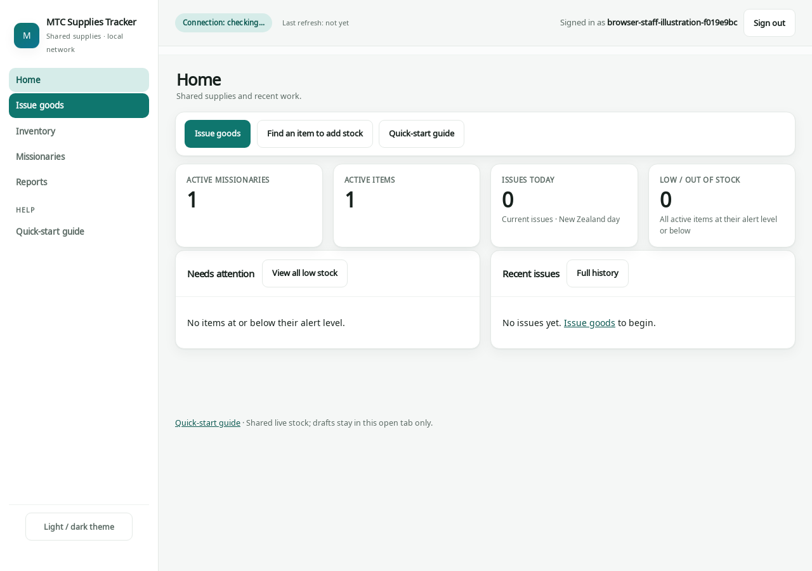

# MTC Supplies Tracker

A small web app for the New Zealand MTC supplies room. Staff record what each
missionary is given, add deliveries, count the shelves and pull reports. It
runs on **one computer in the office**; everyone else just opens a link in
their browser and sees the same, live stock.

It replaces the single-file HTML tracker and can import that file's data
directly. The HTML file itself is **not** in this repository, because it
contains real missionary details; only its original instructions are kept, in
[docs/history](docs/history/prototype-READ-ME.txt).



## What it does

- **Issue supplies** – pick a missionary (shown as “Sister Halvorsen”), click the
  sizes they need, issue in one go. Short stock is caught before anything is saved.
- **Inventory** – sizes in natural order, low-stock alerts, deliveries and shelf
  counts, every change kept in a stock history.
- **Missionaries** – arrival and MTC departure dates, who is leaving soon, and
  what each person has already received.
- **History and Undo** – every issue is kept; a mistake is undone with a reason,
  never deleted.
- **Reports** – stock on hand, reorder list, given-out summaries, intakes; on
  screen, CSV (Excel) or PDF.
- **Safe by default** – staff accounts, nightly verified backups, updates that
  roll themselves back if something fails.

## Using it (staff)

You only need the link and an account from your administrator. The
[Quick-start guide](docs/QUICK_START.md) (also under **Help** in the app) covers
everything in one page.

## Installing it (administrator)

| Where it will run | Guide |
|---|---|
| **A Windows PC in the office** (recommended) | [Install on Windows](docs/INSTALL_WINDOWS.md) – double-click `install.cmd`, about 10 minutes, no Docker |
| A Linux server, or a trial on your own computer | [Install with Docker](docs/INSTALL_DOCKER.md) |
| A Kubernetes cluster | [deploy/kubernetes](deploy/kubernetes/README.md) |

Nothing here needs a paid service or an outside account. The app uses its own
certificate for the secure connection; each guide shows how to make staff PCs
trust it (a one-off step, or a Group Policy push).

### After installing

1. Sign in as the administrator and choose a new password.
2. **Bring in the original tracker** (once, while the app is empty):
   `mtc import-original "MTC Missionary Supplies Tracker.html" -Username admin`
   on Windows. With Docker, run `seed_bundle --source FILE.html --output initial.zip`
   then `import_bundle initial.zip --username admin` (see [Data format](docs/DATA_FORMAT.md#seed-conversion)).
   Either way it reports counts only, never names.
3. Create staff accounts under **Administration → Staff accounts**, with the name
   staff should see (for example “Sister Walker”).
4. Copy the backups folder somewhere else from time to time.

**Just want to look around first?** On an empty trial install,
`python manage.py load_demo_data --username admin` (Windows:
`mtc load_demo_data --username admin`) fills it with invented missionaries,
stock and three weeks of history. It refuses to run if any real data exists.

### Updating

Windows: extract the new release and double-click `deploy\windows\update.cmd`.
It backs up first, pauses saving for a few minutes and puts the old version
back by itself if anything fails. Docker: see
[Operations](docs/OPERATIONS.md#updates-controlled-brief-interruption).

## Privacy

The original HTML file and any real roster contain personal details. They are
never committed to this repository (see `.gitignore`), never put into
screenshots or test data, and should be kept on the server only. Every
screenshot and example in this repository is invented.

## More detail

- [Quick-start guide](docs/QUICK_START.md) – for staff
- [Operations](docs/OPERATIONS.md) – backups, restore, updates, rollback, account recovery
- [Data format](docs/DATA_FORMAT.md) – exports, imports and the full-data bundle
- [Architecture](docs/ARCHITECTURE.md) – how it is built and why
- [Project history](docs/history/) – earlier reviews and the roadmap

### For developers

Python 3.13, Django 5.2 LTS, SQLite (WAL), server-rendered templates with a
little plain JavaScript; no build step and no CDN. Run the checks with:

```sh
uv venv --python 3.13 .venv
uv pip install --python .venv/bin/python -r requirements.txt
mkdir -p .local
.venv/bin/python -m playwright install chromium
.venv/bin/python manage.py check
.venv/bin/python manage.py makemigrations --check --dry-run
.venv/bin/python manage.py test --noinput
.venv/bin/python -m pytest tests/browser
.venv/bin/python -m pytest tests/deployment   # needs Docker
```

Run the suites one after another (they share a test database). All tests use
invented data and block internet access. Working rules for coding agents are
in [AGENTS.md](AGENTS.md).
