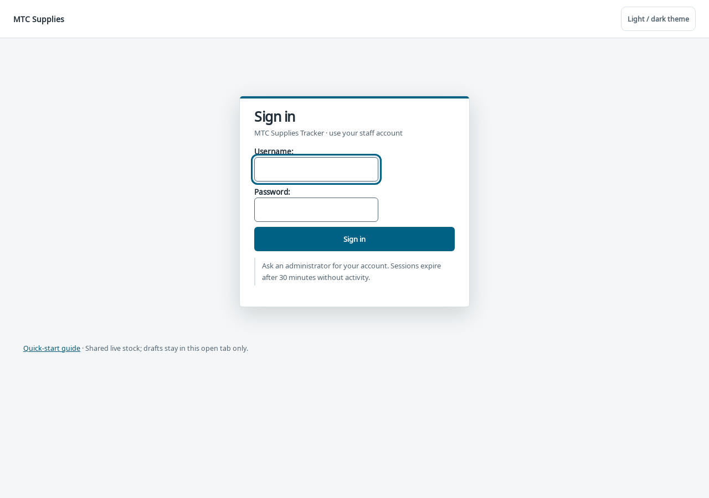
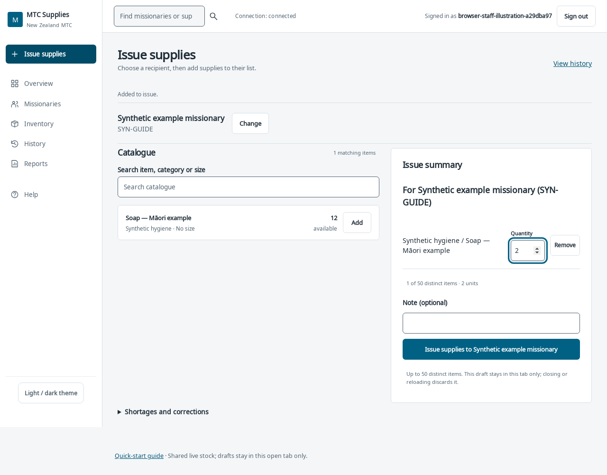
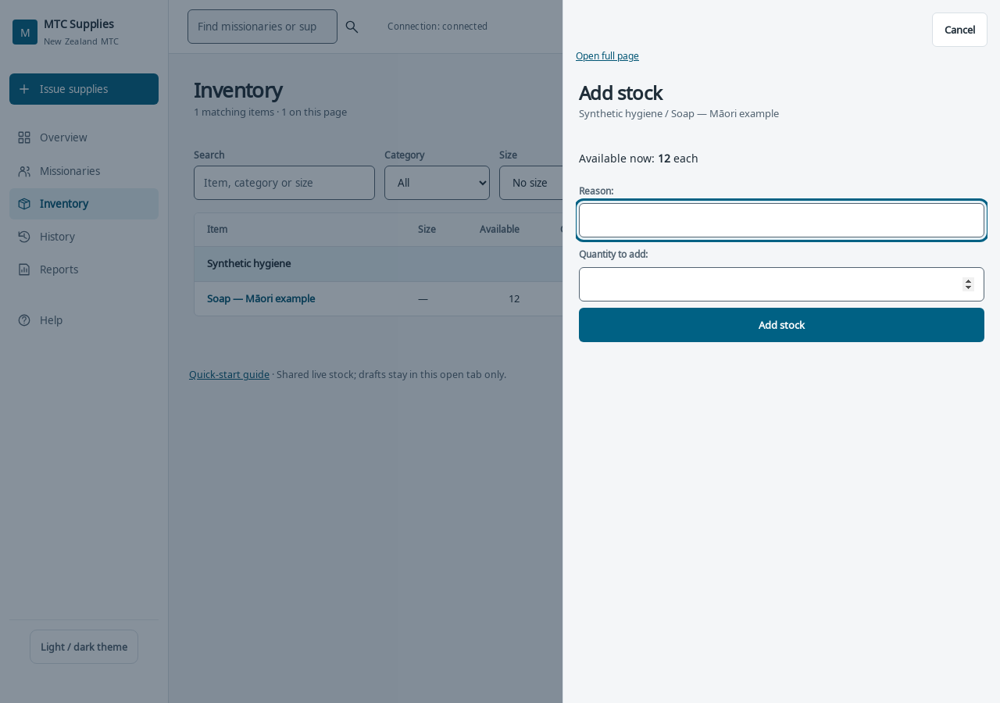
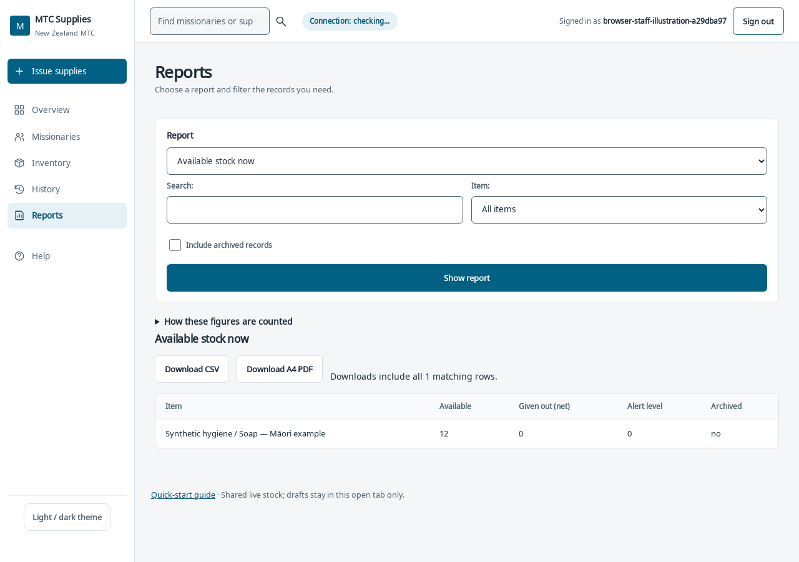

# Quick-start guide (one page)

You need only a **browser link and a staff account**. All examples are synthetic.
Overview shows low stock and recent work. On a narrow screen, **Menu** reaches every
section, help and the light/dark theme.

## 1. Sign in

Ask an administrator for your account. Change a temporary password on first
sign-in. Check your username at the top; sign out when leaving a shared computer.

## 2. Issue supplies

Open **Issue supplies** (also available from a missionary’s profile).
Type a name or ID and **choose a suggestion** (arrows and Enter work too).
Check the selected identity. Use **Add** on catalogue rows, then adjust quantities
in the summary. Repeat: the same item combines into one line;
up to **50 distinct items** are allowed. Review the named summary and quantities,
then choose **Issue supplies**. **Change** clears items/note after confirmation.

If stock is short, **nothing is issued yet**. Review “You asked for / Available
now / Revised quantity” and **Confirm revised quantities**, or choose **Back
without issuing** to retain the original draft. Confirmation rechecks stock.

## 3. Add stock or correct a count

Use **Inventory** row actions to open a short panel (the item page also has these
actions). Closing returns to the same filters/page/position; unsaved changes need
confirmation. Use **Add stock** for a delivery, with quantity
and reason. Use **Correct stock count** for the actual shelf count, with a reason;
it records a correction, never an issue. A stale count keeps your input but needs
review: check current stock in another tab, reopen the item and count again.

For several new items, choose **Add multiple items**, fill up to 50 rows, then
**Review items → Save all items**. Every item saves together, or none does.

## 4. Undo a mistake

Open **History**, filter/page to the issue and open it. Give a reason
and choose **Undo this issue**. All goods in that issue return to Available, once
only; the original record and staff attribution stay in history.

**Reports** selects one report with shared screen/CSV/A4 PDF filters. Downloads
include all matching rows. Current net excludes all undone issues (even those
undone later); Available stock is stock **now**, not as-of a date.
Low-stock reports also offer **Copy list** and **Open your mail app**; the app
sends no email. The header finder opens people/items; local search filters lists.

## Keep an unfinished draft safe

- Drafts last **only in this open tab**. Reload/close discards them. No autosave,
  personal browser storage, offline queue or background mutation.
- Idle sign-in expires after 30 minutes. Keep the draft tab open, sign in in a
  different tab **as the same staff member**, then retry here. The app refreshes
  security tokens and checks identity; it never submits automatically.
- Offline/no reply: success can be uncertain. Retry the **same original request**
  deliberately, or inspect History in another tab. Do not start a duplicate issue.
- Numbers refresh about every 15 seconds without changing inputs/focus or renewing
  idle sign-in. Keyboard: Tab between controls, arrows/Enter choose suggestions,
  Escape closes suggestions or a panel, Enter activates an Add button.
